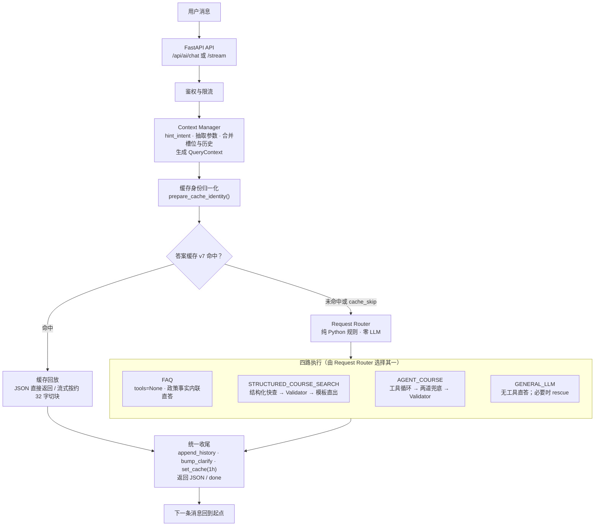

# ITCloud AI Service

**AI-powered Course Recommendation and Retrieval Service**

ITCloud AI Service 是一个基于 Python 的课程问答与检索服务。它以 FastAPI 提供 HTTP/SSE 接口，通过 Agent 编排、课程 RAG 检索、会话记忆和缓存，为课程查询、课程推荐以及相关技术问答提供服务。

本仓库是独立发布副本。在线服务运行时主要依赖 Chroma、Redis、RabbitMQ、OpenAI 兼容的 LLM API，以及本地 Hugging Face Embedding/Reranker 模型；在线请求不会直接连接业务 MySQL。

## 主要功能

- **Agent 编排**：根据请求类型在 FAQ、结构化课程检索、LLM 工具循环和通用回答之间选择处理路径。
- **意图识别与上下文管理**：使用本地规则提取课程分类、难度、预算、技术关键词和会话槽位。
- **混合 RAG 检索**：向量召回与 BM25 关键词召回通过 RRF 融合，再使用本地 Cross-Encoder Reranker 精排。
- **课程卡片与回答分离**：课程检索结果可作为结构化 `courses` 数据返回，同时作为上下文支持 LLM 生成回答。
- **Redis 会话能力**：会话历史、答案缓存、槽位、限流计数和课程意图缓存使用不同逻辑库隔离。
- **RabbitMQ 课程事件**：后台消费者处理课程新增、更新和删除事件，并更新 Chroma 与 Redis 意图缓存。
- **SSE 流式响应**：流式接口发送 `intent`、`courses`、`chunk`、`done` 和 `error` 事件。
- **可选联网搜索**：支持 Tavily、SerpAPI、Serper；未配置搜索 Key 时回退到 DuckDuckGo HTML 搜索。
- **鉴权与限流**：生产模式支持网关服务令牌、用户 JWT、JWT 黑名单、每分钟频率限制和单用户并发限制。

## 系统架构



### 请求处理概览

1. FastAPI 接收请求并执行鉴权、限流和会话 ID 归一化。
2. Context Manager 合并当前消息、历史和槽位，形成本次请求的有效过滤条件。
3. `prepare_cache_identity()` 生成规范化缓存身份；答案缓存命中时直接回放，不进入 Request Router。
4. 缓存未命中或因上下文追问跳过缓存时，Request Router 使用确定性 Python 规则选择四条执行路径：FAQ、结构化课程检索、Agent 或通用 LLM。
5. 结构化课程检索和 Agent 课程工具都可以进入课程 RAG；课程检索使用 Chroma 向量、BM25、RRF 和 Reranker，结果通过 Validator 检查硬约束。
6. 所有路径进入统一收尾，写入 Redis 缓存/会话记忆，并以 JSON 或自定义 JSON 分帧流式响应返回。

当前默认混合检索配置为 Vector Top 40 + BM25 Top 20，RRF 权重为 `[1.0, 0.3]`，再进行本地重排。`RAG_QU`、`RAG_QREWRITE` 等实验开关默认关闭。

## 技术栈

| 类别 | 技术 |
| --- | --- |
| Web 服务 | Python 3.11、FastAPI、Uvicorn |
| LLM | `openai` Python SDK，支持 OpenAI-compatible API |
| RAG | ChromaDB、Sentence-Transformers、Jieba、BM25、RRF |
| 本地模型 | `shibing624/text2vec-base-chinese`、`BAAI/bge-reranker-v2-m3`（可通过环境变量替换） |
| 缓存与记忆 | Redis 5.x |
| 消息队列 | RabbitMQ、`aio-pika` |
| 鉴权 | PyJWT，支持 HS256/HS384/HS512 |
| 外部 HTTP | HTTPX，用于后端回源和联网搜索 |

项目当前没有使用 LangChain 作为在线 Agent 执行框架；Agent 由项目自身的 Python 模块实现。

## 目录结构

```text
.
├── app/
│   ├── agent/       # Agent 编排、工具、请求路由和课程推荐
│   ├── api/         # FastAPI 路由
│   ├── core/        # 鉴权、JWT 黑名单和限流
│   ├── mq/          # RabbitMQ 课程事件消费者与定时重建
│   ├── models/      # Pydantic 请求/响应模型
│   ├── rag/         # Chroma、Embedding、BM25、RRF、Reranker 和语料导入
│   └── services/    # Redis 缓存、记忆、槽位、FAQ、联网搜索和指标
├── Dockerfile
├── requirements.txt
├── .env.example
├── .gitignore
├── .dockerignore
└── README.md
```


## 环境要求

- Python 3.11（Dockerfile 使用 `python:3.11-slim`）
- 一个可访问的 Redis 服务
- 一个可访问的 ChromaDB server
- 一个可访问的 RabbitMQ 服务（若启用课程事件消费者）
- 一个 OpenAI-compatible LLM API
- 本地可加载的 Embedding 和 Reranker 模型缓存
- 生产环境还需要后端网关/JWT 配置，以及课程全量重建所需的后端内部 API

Embedding 和 Reranker 使用 `local_files_only=True` 加载，不会在服务启动时自动从 Hugging Face 下载模型。请在启动前准备好模型缓存，或将缓存通过镜像/卷挂载到运行环境。

## 本地安装

### Windows PowerShell

```powershell
py -3.11 -m venv .venv
.\.venv\Scripts\Activate.ps1
python -m pip install -r requirements.txt
Copy-Item .env.example .env
```

### Linux / macOS

```bash
python3.11 -m venv .venv
source .venv/bin/activate
python -m pip install -r requirements.txt
cp .env.example .env
```

编辑 `.env`，至少准备 LLM、Redis 和 Chroma 配置。`main.py` 会自动加载项目根目录下的 `.env`。

## 配置说明

下面只列出运行时最重要的配置；完整变量名和占位值请以 `.env.example` 为准。

| 变量 | 用途 |
| --- | --- |
| `OPENAI_API_KEY` | LLM API 密钥 |
| `OPENAI_BASE_URL` | OpenAI-compatible API 地址 |
| `LLM_MODEL` | 对话和标签抽取模型，默认 `gpt-4o-mini` |
| `EMBEDDING_MODEL` | 本地 Embedding 模型 |
| `RERANKER_MODEL` | 本地 Cross-Encoder 模型 |
| `CHROMA_HOST` / `CHROMA_PORT` | ChromaDB server 地址 |
| `REDIS_HOST` / `REDIS_PORT` / `REDIS_PASSWORD` | Redis 连接配置 |
| `REDIS_DB` | AI 会话、缓存、限流和指标逻辑库 |
| `REDIS_INTENT_DB` | 课程意图、标签和索引版本逻辑库 |
| `BACKEND_REDIS_DB` | 后端 JWT 黑名单所在逻辑库，通常为 DB 0 |
| `RABBITMQ_HOST` / `RABBITMQ_PORT` | RabbitMQ 地址 |
| `RABBITMQ_USERNAME` / `RABBITMQ_PASSWORD` | RabbitMQ 凭据 |
| `COURSE_MQ_QUEUE` | 课程事件队列，默认 `queue.course.ai` |
| `BACKEND_BASE_URL` | 课程全量重建时访问的后端地址 |
| `INTERNAL_API_TOKEN` | 后端内部接口令牌，不得与 `AI_SERVICE_TOKEN` 混用 |
| `WEB_SEARCH_PROVIDER` 及各供应商 Key | 可选联网搜索 |
| `CORS_ORIGINS` | 允许访问的前端 Origin |
| `AI_SERVICE_PORT` | 直接运行 `app.main` 时使用的端口 |

### 开发环境与生产鉴权

本地受控联调可以使用：

```dotenv
AI_REQUIRE_AUTH=false
```

公开生产部署必须显式设置：

```dotenv
AI_REQUIRE_AUTH=true
AI_SERVICE_TOKEN=YOUR_AI_SERVICE_TOKEN
JWT_SECRET=YOUR_BASE64_JWT_SECRET
```

鉴权开启后，`/api/ai/*` 业务路由需要同时满足：

```http
X-API-Token: <AI_SERVICE_TOKEN>
Authorization: Bearer <USER_JWT>
```

`JWT_SECRET` 必须是与后端相同的 Base64 密钥；用户 JWT 的签发方、算法和过期时间必须与后端约定一致。`AI_SERVICE_TOKEN` 是网关到 AI 服务的服务令牌，`INTERNAL_API_TOKEN` 是 AI 服务访问后端内部课程接口的令牌，两者用途不同，不能混用。

AI 服务当前使用 `BACKEND_REDIS_DB` 查询后端 JWT 登出黑名单。该库必须与后端实际配置一致。频率限流和并发限流使用 `AI_RATE_LIMIT_PER_MIN`、`AI_MAX_CONCURRENCY_PER_USER` 等变量。

以下端点在当前代码中不挂载业务鉴权依赖：

- `GET /`
- `GET /health`
- `GET /health/ready`
- FastAPI 自动文档：`/docs`、`/redoc`、`/openapi.json`

生产网关应根据部署要求限制健康检查和文档端点的访问，或关闭不需要公开的文档。

## 启动服务

从仓库根目录运行：

```bash
uvicorn app.main:app --host 0.0.0.0 --port 8000 --reload
```

生产环境通常应去掉 `--reload`，并由进程管理器或容器负责生命周期。

启动阶段会预热 Embedding 模型，然后挂载 RabbitMQ 消费者和每日索引重建调度。RabbitMQ 凭据缺失时，消费者会记录配置错误并持续重试，但不会因此让 FastAPI 主服务退出。

## 演示课程数据

`app/rag/course_corpus.example.json` 包含 30 条合成化课程记录，用于展示课程语料结构和 RAG 检索格式。它不包含生产课程内容、真实教师信息、内部课程 ID 或真实课程编码。

`app/rag/ingest.py` 的默认路径仍然是 `app/rag/course_corpus.json`。演示文件不会自动替代默认语料，必须显式传入路径：

```bash
python -c "from app.rag.ingest import ingest_from_corpus; print(ingest_from_corpus('app/rag/course_corpus.example.json'))"
```

执行前请确保：

- ChromaDB server 已启动并可访问；
- Embedding 模型缓存已准备好；
- 当前工作目录是仓库根目录；
- 你明确知道该命令会向 Chroma 集合 `itcloud_courses` 写入演示索引。

## API 使用

API 路由统一位于 `/api/ai`。当 `AI_REQUIRE_AUTH=false` 时可用于本地受控调试；生产环境请按上文提供双层鉴权请求头。

### 非流式对话

```http
POST /api/ai/chat
Content-Type: application/json
```

请求体：

```json
{
  "message": "推荐 200 元以内的 Python 入门课程",
  "session_id": "demo-session"
}
```

`user_id` 字段虽然仍存在于请求模型中，但鉴权开启后服务不会信任客户端自报值，用户身份来自 JWT 的 `sub`。

响应结构：

```json
{
  "intent": "course_recommend",
  "answer": "这里是基于课程检索结果生成的回答。",
  "courses": [
    {
      "id": "course-id",
      "course_name": "课程名称",
      "category": "data",
      "level": "beginner",
      "price": 99.0,
      "match_reason": "匹配理由"
    }
  ],
  "confidence": 0.9
}
```

### 流式对话

```http
POST /api/ai/chat/stream
Content-Type: application/json
Accept: text/event-stream
```

响应的 `Content-Type` 为 `text/event-stream`。当前实现按 JSON 对象序列发送数据帧，每帧后以两个换行符（`\n\n`）分隔：

```text
{"type":"intent","data":"course_recommend","timestamp":"..."}
{"type":"courses","data":[...],"timestamp":"..."}
{"type":"chunk","data":"回答片段","timestamp":"..."}
{"type":"done","data":"","timestamp":"..."}
```

这属于项目当前使用的 JSON 分帧格式，不是包含 `data:` 字段的标准 SSE 事件帧。客户端应按 JSON 帧和空行分隔符解析；仅凭 `Content-Type` 不能保证浏览器原生 `EventSource` 兼容。异常时会发送 `type=error`。流式接口会在流开始前执行限流和并发检查。

### 课程推荐

```http
GET /api/ai/recommend?query=我想学Python入门&limit=3&category=data
```

参数：

- `query`：必填的课程查询描述；
- `limit`：1 到 20，默认 5；
- `category`：可选分类约束，例如 `backend`、`frontend`、`data`、`devops`。

响应结构：

```json
{
  "query": "我想学Python入门",
  "total": 1,
  "courses": [
    {
      "id": "course-id",
      "course_name": "课程名称",
      "match_reason": "匹配理由"
    }
  ]
}
```

### 会话历史、健康与指标

| 方法 | 路径 | 说明 | 鉴权 |
| --- | --- | --- | --- |
| `GET` | `/api/ai/history?session_id=demo-session` | 读取当前用户 24 小时内的会话历史 | 是 |
| `GET` | `/api/ai/health` | 业务健康状态 | 是 |
| `GET` | `/api/ai/metrics` | 读取 Redis 中的运行计数器 | 是 |
| `GET` | `/health` | 容器存活探测 | 否 |
| `GET` | `/health/ready` | Embedding 预热就绪探测，未就绪时返回 503 | 否 |

## Docker 部署

当前仓库只有 `Dockerfile`，没有 `docker-compose.yml`。因此 Redis、RabbitMQ、ChromaDB、模型缓存和后端 API 必须由外部环境提供，不能把 Compose 编排描述为本项目已经实现的功能。

构建镜像：

```bash
docker build -t itcloud-ai-service .
```

运行容器：

```bash
docker run --rm \
  --name itcloud-ai-service \
  -p 8000:8000 \
  --env-file .env \
  itcloud-ai-service
```

Dockerfile 的实际行为：

- 基于 `python:3.11-slim`；
- 安装 GCC；
- 先安装 CPU 版 `torch==2.4.1`，再安装 `requirements.txt`；
- 工作目录为 `/app`；
- 暴露端口 `8000`；
- 启动命令为 `uvicorn app.main:app --host 0.0.0.0 --port 8000 --log-level info`。

容器内的 `localhost` 指向容器自身。使用容器网络运行 Redis、RabbitMQ 或 Chroma 时，应把 `.env` 中的主机名改为对应服务名。当前 Dockerfile 不会自动下载 Embedding/Reranker 模型；请通过镜像内容或模型缓存卷准备离线模型。

## 注意事项与限制

- 这是一个依赖外部服务的 AI 服务，不是开箱即用的单进程演示应用。
- 在线课程检索依赖已经写入 Chroma 的课程索引；运行时不直接查询业务 MySQL。
- 课程事件和每日全量重建依赖 RabbitMQ 以及后端内部课程接口。
- 演示语料仅用于公开展示数据结构，不等同于生产课程数据。
- 联网搜索是可选能力；未配置供应商 Key 时 DuckDuckGo 结果可能受网络环境限制。
- 生产环境必须开启 `AI_REQUIRE_AUTH=true`，并正确配置服务令牌、JWT 密钥和 Redis 黑名单库。
- 公开部署前应由网关决定健康检查、FastAPI 文档和 OpenAPI 端点是否对外开放。

## 开发说明

- 业务代码位于 `app/`。
- RAG 语料导入入口为 `app.rag.ingest.ingest_from_corpus(path=...)`。
- 公开仓库不包含生产课程语料；使用演示数据时请显式传入 `app/rag/course_corpus.example.json`。
